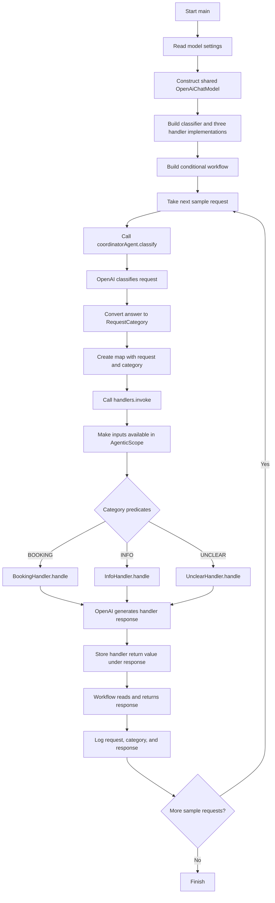

# Chapter 2: Routing with LangChain4j

## The routing pattern

Routing classifies an incoming request and directs it to specialized processing. Each destination can have its own instructions, tools, and behavior, while the routing step decides which destination is appropriate. This separates classification from execution and avoids giving one general-purpose prompt responsibility for every kind of request.

> **Note:** The “Workflow: Routing” section of Anthropic's [Building Effective Agents](https://www.anthropic.com/research/building-effective-agents) explains classification and routing to specialized processing, with a diagram, use cases, and examples.

These notes describe the current source in this package. They explain construction and execution separately and identify the current standalone-agent warning. No live API requests or builds were performed for this documentation update.

## What this example demonstrates

`RoutingExample.main()` builds one model wrapper, a classifier, three handlers, and a conditional workflow. It then processes three sample requests sequentially.

| Sample request | Intended category | Selected handler |
| --- | --- | --- |
| `Book me a flight to London.` | `BOOKING` | `BookingHandler` |
| `What is the capital of Italy?` | `INFO` | `InfoHandler` |
| `Do that thing for me.` | `UNCLEAR` | `UnclearHandler` |

These are intended classifications, not assertions about captured model results. The model's actual classification determines the branch.

Unlike the Python example's simulated string-returning functions, these handlers are model-backed interfaces. On a normal successful path, each request makes two model calls: one for classification and one for the selected handler. Three sample requests therefore normally produce six model calls; retries can cause additional attempts.

The model chooses a category. Java predicates choose the handler. The selected handler receives the original request, not merely the category name.

## Flow diagram



This shows the normal successful path. Authentication, network, parsing, or workflow errors can interrupt execution; the current `main()` does not catch them. Mermaid-capable Markdown viewers render the diagram; other viewers show its source.

## Class and interface diagram


The arrows represent usage in this example, not inheritance. LangChain4j creates runtime implementations of the four application interfaces; no handwritten implementation classes exist for them. The `UntypedAgent` instance represents the conditional workflow, rather than a class implementing our three handler interfaces.

## 1. Settings and model construction

[`ProviderModelSettings`](../provider/ProviderModelSettings.java) holds two `public static final` strings. `API_KEY` reads `OPENAI_API_KEY` from the process environment, and `MODEL_NAME` is `gpt-4o-mini`.

`System.getenv(...)` does not load a `.env` file. A missing variable returns `null`; the settings class does not validate it. Never print the API key to diagnose configuration.

In [`RoutingExample.java`](RoutingExample.java), this builder constructs the model wrapper:

```java
OpenAiChatModel model = OpenAiChatModel.builder()
        .apiKey(ProviderModelSettings.API_KEY)
        .modelName(ProviderModelSettings.MODEL_NAME)
        .build();
```

`modelName(...)` receives a string identifying the remote model. Later, `chatModel(model)` receives the configured object that knows how to call it. These are different parameter types and responsibilities. Constructing this wrapper does not itself submit a classification request.

Sharing the wrapper avoids repeating connection and model configuration. It does not mean the agents automatically share conversation history or that their system instructions are combined.

## 2. Interfaces as executable service declarations

Each agent interface declares one abstract method. Java implicitly makes these interface methods `public abstract`; the declarations have no method bodies.

LangChain4j reads the annotations and supplies an implementation at runtime:

```java
BookingHandler bookingHandler = AgenticServices.agentBuilder(BookingHandler.class)
        .chatModel(model)
        .outputKey("response")
        .build();
```

- `BookingHandler.class` supplies the runtime type of the interface.
- `agentBuilder(...)` starts construction of an agent implementing that interface.
- `chatModel(model)` connects the agent to the shared model wrapper.
- `outputKey("response")` names the shared-state entry for its returned value when it runs in a workflow.
- `build()` returns an object assignable to `BookingHandler`.

The three handlers can all declare `handle(String request)` because they have separate generated implementation objects. They do not require one handwritten class implementing all three interfaces.

### Annotation roles

| Annotation | Meaning in this example |
| --- | --- |
| `@Agent("...")` | Marks the agent entry-point method and describes it to the framework. It does not itself select a conditional branch. |
| `@SystemMessage("...")` | Supplies behavioral instructions as a system message. |
| `@UserMessage("{{request}}")` | Supplies a user-message template containing the original request. |
| `@V("request")` | Names the argument used for template binding and agent input resolution. |

The annotations above a method describe that method; `@V` annotates its parameter. Java text blocks (`"""..."""`) supply multiline strings. Double braces such as `{{request}}` are LangChain4j template syntax, not Java interpolation.

For example, the booking agent receives its booking instructions as a system message and `Book me a flight to London.` as a user message. `SYSTEM:` and `USER:` labels in explanatory examples represent message roles; they are not literal prefixes inserted into the prompt. The category is not part of these handler messages.

System instructions influence model behavior; they are not Java-enforced guarantees about the returned text.

## 3. CoordinatorAgent: obtaining a category

[`CoordinatorAgent`](CoordinatorAgent.java) declares:

```java
RequestCategory classify(@V("request") String request);
```

Its system instructions define booking, information, and unclear categories and request only a category name. The method's return type tells LangChain4j to convert the model answer into the [`RequestCategory`](RequestCategory.java) enum. Conversion can fail if the response cannot be interpreted as a supported value; this is not an automatic fallback to `UNCLEAR`.

The enum keeps branch comparisons explicit and avoids scattering free-form label strings through Java conditions. It contains only constants and makes no model calls.

The current classifier builder also sets `outputKey("response")`. That setting does not automatically place the classification in the conditional workflow's `category` field. In this implementation, `main()` receives the enum directly and explicitly inserts it into the input map.

## 4. The handler contracts

| Interface | Return type | Instructions |
| --- | --- | --- |
| [`BookingHandler`](BookingHandler.java) | `String` | Briefly acknowledge the travel request, without asking questions or claiming a booking or availability check. |
| [`InfoHandler`](InfoHandler.java) | `String` | Briefly answer a general knowledge question, acknowledge uncertainty, and avoid claims of live searches or follow-up questions. |
| [`UnclearHandler`](UnclearHandler.java) | `String` | Reply only `Your request was unclear.` without asking questions. |

The interfaces contain full prompt examples in their Javadoc. None is configured with booking tools, web search, or external business services. The booking response is an acknowledgment, and the information answer comes from the model rather than a live retrieval system.

Although an exact fixed response could be returned by ordinary Java, the unclear branch deliberately remains model-backed to demonstrate separate subagents. Its second model call is educational rather than necessary for generating that fixed sentence.

## 5. Conditional workflow: selecting the handler

The workflow is constructed through `AgenticServices.conditionalBuilder()` and held in an `UntypedAgent` variable.

```java
.subAgents(
        scope -> scope.readState("category") == RequestCategory.BOOKING,
        bookingHandler)
```

The first argument is a predicate expressed as a Java lambda. The second is the object to execute when the predicate is true. `scope.readState("category")` reads the category from the current `AgenticScope`, and `==` compares it with an enum constant.

All applicable conditions can run; this builder is not inherently a first-match `if/else` chain. Our three equality checks are mutually exclusive, so a valid category selects one handler. There is no unconditional default branch: `UNCLEAR` is an explicit enum match. Missing or incorrect category state should not be assumed to select it.

The predicates make no model calls. They select the already-constructed agent whose execution then calls the model.

### Why UntypedAgent?

`UntypedAgent` provides a generic `invoke(...)` entry point without requiring a custom Java interface for the combined workflow. Inputs are supplied through a map and the result is held as `Object`, unlike the handlers' explicitly declared `String` methods.

“Untyped” refers to the application-specific workflow contract, not to Java disabling type checking. Map keys and the expected runtime value types still need to agree with the predicates and agent parameters.

## 6. Maps, shared state, and response selection

Each loop iteration supplies:

```java
Map<String, Object> arguments = Map.of(
        "request", request,
        "category", category
);
```

`Map.of(...)` creates an unmodifiable map. It allows a string request and enum category under a common `Object` value type, but rejects null keys and values. The workflow uses its entries as input state; this does not mean LangChain4j mutates the original map.

| State name | Value | Used by |
| --- | --- | --- |
| `request` | Original request string | Selected handler's `@V("request")` parameter. |
| `category` | `RequestCategory` enum | Conditional branch predicates. |
| `response` | Selected handler's returned string | Workflow output function. |

All three handlers use `outputKey("response")` because only one runs for each valid category. The workflow then selects that value explicitly:

```java
.output(scope -> scope.readState("response"))
```

This lambda defines what `handlers.invoke(arguments)` returns. An output key stores a result; an output function chooses the workflow's returned value. They serve different purposes.

## 7. Construction versus execution

The setup occurs once, before the loop. The actual requests occur inside it:

```java
RequestCategory category = coordinatorAgent.classify(request);
// Build the request/category map here.
Object response = handlers.invoke(arguments);
```

1. `classify(request)` makes the classification model call and returns an enum.
2. Java places the original request and enum into the input map.
3. `invoke(arguments)` evaluates the registered conditions.
4. The matching handler receives the original request and makes its own model call.
5. The workflow returns the handler's stored response.
6. SLF4J logs the request, category, and response.

The loop reuses the constructed objects for each sample. It does not intentionally execute every handler for a single request. The three samples are intended to demonstrate all branches across separate invocations.

## 8. The standalone-agent warning and the API choice

The current code creates the coordinator with `AgenticServices.agentBuilder(...)` but calls `coordinatorAgent.classify(request)` directly, outside a managed agentic workflow. This explains the reported warning:

```text
Improper invocation of a standalone agent outside of an agentic system,
consider using AiServices instead.
```

The handlers are invoked inside the conditional workflow, so their use is different. There are two possible refinements; neither has been implemented as part of these notes:

- Keep explicit classification in `main()` and construct the standalone classifier through `AiServices`. This API suits a model-backed Java service called directly through its interface.
- Keep the coordinator as an agent and place classification and conditional routing inside an `AgenticServices.sequenceBuilder(...)` workflow. The classifier would write `category` into shared state, the conditional workflow would read it, and the caller would supply only `request`.

`AiServices` is not universally better practice. The choice depends on whether the component is a standalone service or a participant in managed orchestration. The current manual two-step form makes data flow visible but retains the warning.

## 9. Relationship to the Python example

| Concern | Python LangChain version | Current Java version |
| --- | --- | --- |
| Model wrapper | `ChatOpenAI` | `OpenAiChatModel` |
| Prompt definition | `ChatPromptTemplate` and role/text tuples | Interface annotations. |
| Classification result | Text from `StrOutputParser` | Enum returned through the classifier interface. |
| Branch selection | `RunnableBranch` | `conditionalBuilder()` with category predicates. |
| Original input | Preserved in a nested request dictionary | Passed as a flat `request` map entry. |
| Handler behavior | Simulated Python string responses | Model calls with specialized instructions. |
| Returned result | Final chain extracts `output` | Workflow output function reads `response`. |

The direct OpenAI Python alternative uses explicit API calls and `if/elif/else`. This Java example intentionally uses LangChain4j's generated interface implementations and conditional workflow to make the framework's orchestration visible.

Model routing is a related but separate application of routing: it selects which underlying model handles a call. Here, all agents share one configured model wrapper, and routing selects specialized behavior instead.

## 10. Running and current limitations

Run `RoutingExample` as a Java Application in Eclipse, with `OPENAI_API_KEY` available to the launched process. Maven compilation builds classes; it does not execute `main()`. Running `main()` sends live model requests.

The owning Maven project targets Java 17 and includes `langchain4j`, `langchain4j-open-ai`, and `langchain4j-agentic`. The agentic module has a beta version and its APIs may evolve. Logging uses SLF4J bridged to Log4j 2.

The current example logs final results, but this does not establish that every logging rule in `java/AGENTS.md` is implemented. In particular, method tracing, debugger-sensitive thresholds, separate prompt/response JSON logging, and safe per-attempt HTTP metadata logging require their own implementation and verification. Do not enable unrestricted wire logging to obtain them.

Other limits are intentional or remain unresolved:

- No real booking action, live search, conversation loop, or human follow-up is implemented.
- Classification and exact handler wording depend on model output; prompts alone do not guarantee compliance.
- Exceptions propagate from `main()`; the example does not recover from failed calls or enum conversion.
- A shared model wrapper does not automatically connect the standalone coordinator's state to the conditional workflow.
- The existing standalone-agent warning remains; these notes document it rather than silently changing the design.
- These notes describe source behavior and intended execution, not a newly verified end-to-end run.

## References

- [LangChain4j agents and agentic workflows](https://docs.langchain4j.dev/tutorials/agents/)
- [LangChain4j AI Services](https://docs.langchain4j.dev/tutorials/ai-services/)
- [Official conditional workflow example](https://github.com/langchain4j/langchain4j-examples/tree/main/agentic-tutorial/src/main/java/_5_conditional_workflow)
- [Python routing notes](../../../../../../../../../../python/chapter_notebooks/notes/Chapter_02_Routing_langchain_openai_notes.md)

> **Note:** This document was generated by Codex.
