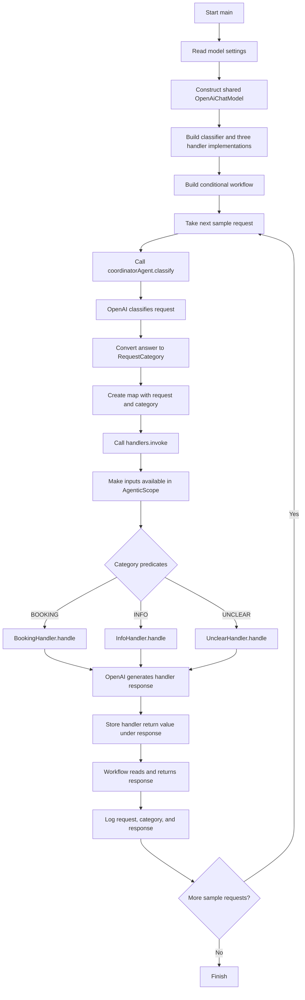
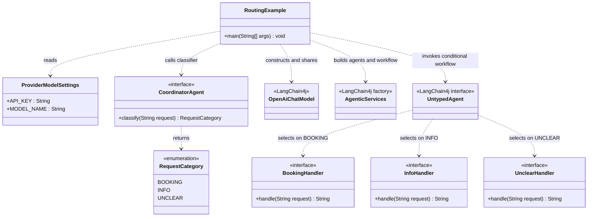
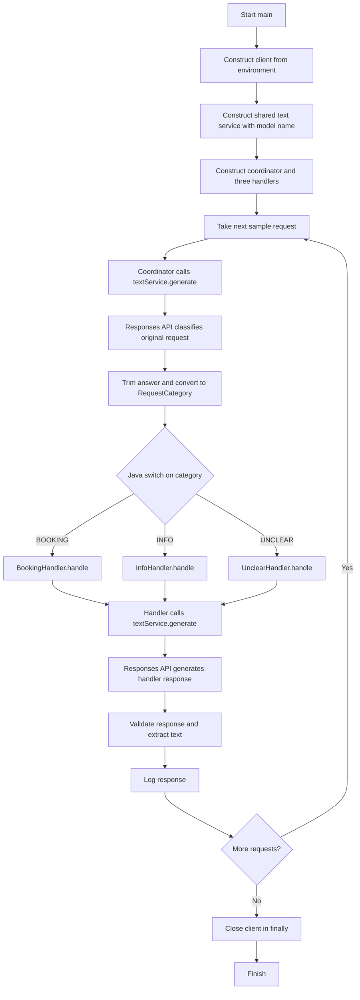
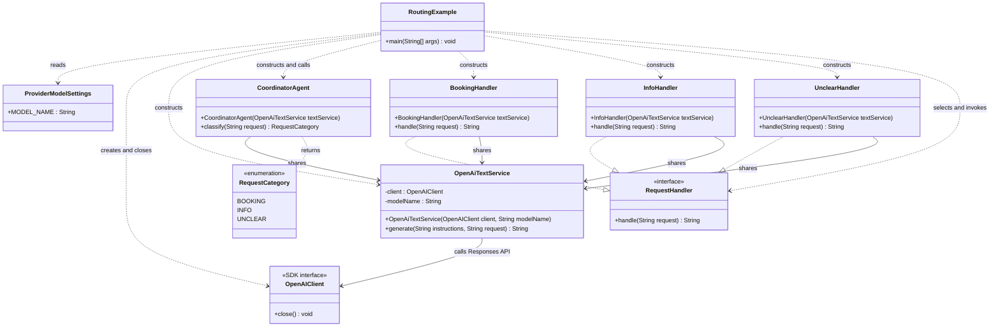

# Chapter 2: Routing with LangChain4j and OpenAI

## The routing pattern

Routing classifies an incoming request and directs it to specialized processing. Each destination can have its own instructions, tools, and behavior, while the routing step decides which destination is appropriate. This separates classification from execution and avoids giving one general-purpose prompt responsibility for every kind of request.

> **Note:** The “Workflow: Routing” section of Anthropic's [Building Effective Agents](https://www.anthropic.com/research/building-effective-agents) explains classification and routing to specialized processing, with a diagram, use cases, and examples.

These notes describe a LangChain4j conditional workflow and an explicit workflow using the official OpenAI Java SDK. Both separate classification from execution. No builds or live API requests were performed for this documentation update.

## Part 1: Routing with LangChain4j

### What this example demonstrates

`RoutingExample.main()` builds one model wrapper, a classifier, three handlers, and a conditional workflow. It then processes three sample requests sequentially.

| Sample request | Intended category | Selected handler |
| --- | --- | --- |
| `Book me a flight to London.` | `BOOKING` | `BookingHandler` |
| `What is the capital of Italy?` | `INFO` | `InfoHandler` |
| `Do that thing for me.` | `UNCLEAR` | `UnclearHandler` |

These are intended classifications, not assertions about captured model results. The model's actual classification determines the branch.

Unlike the Python example's simulated string-returning functions, these handlers are model-backed interfaces. On a normal successful path, each request makes two model calls: one for classification and one for the selected handler. Three sample requests therefore normally produce six model calls; retries can cause additional attempts.

The model chooses a category. Java predicates choose the handler. The selected handler receives the original request, not merely the category name.

### Flow diagram



This shows the normal successful path. Authentication, network, parsing, or workflow errors can interrupt execution; the current `main()` does not catch them. Mermaid-capable Markdown viewers render the diagram; other viewers show its source.

### Class and interface diagram



The arrows represent usage in this example, not inheritance. LangChain4j creates runtime implementations of the four application interfaces; no handwritten implementation classes exist for them. The `UntypedAgent` instance represents the conditional workflow, rather than a class implementing our three handler interfaces.

### 1. Settings and model construction

[`ProviderModelSettings`](../langchain4j/src/main/java/com/jamesabrannan/agenticpatterns/langchain4j/provider/ProviderModelSettings.java) holds two `public static final` strings. `API_KEY` reads `OPENAI_API_KEY` from the process environment, and `MODEL_NAME` is `gpt-4o-mini`.

`System.getenv(...)` does not load a `.env` file. A missing variable returns `null`; the settings class does not validate it. Never print the API key to diagnose configuration.

In [`RoutingExample.java`](../langchain4j/src/main/java/com/jamesabrannan/agenticpatterns/langchain4j/routing/RoutingExample.java), this builder constructs the model wrapper:

```java
OpenAiChatModel model = OpenAiChatModel.builder()
        .apiKey(ProviderModelSettings.API_KEY)
        .modelName(ProviderModelSettings.MODEL_NAME)
        .build();
```

`modelName(...)` receives a string identifying the remote model. Later, `chatModel(model)` receives the configured object that knows how to call it. These are different parameter types and responsibilities. Constructing this wrapper does not itself submit a classification request.

Sharing the wrapper avoids repeating connection and model configuration. It does not mean the agents automatically share conversation history or that their system instructions are combined.

### 2. Interfaces as executable service declarations

Each agent interface declares one abstract method. Java implicitly makes these interface methods `public abstract`; the declarations have no method bodies.

LangChain4j reads the annotations and supplies an implementation at runtime:

```java
BookingHandler bookingHandler = AgenticServices.agentBuilder(BookingHandler.class)
        .chatModel(model)
        .outputKey("response")
        .build();
```

- `BookingHandler.class` supplies the runtime type of the interface.
- `agentBuilder(...)` starts construction of an agent implementing that interface.
- `chatModel(model)` connects the agent to the shared model wrapper.
- `outputKey("response")` names the shared-state entry for its returned value when it runs in a workflow.
- `build()` returns an object assignable to `BookingHandler`.

The three handlers can all declare `handle(String request)` because they have separate generated implementation objects. They do not require one handwritten class implementing all three interfaces.

#### Annotation roles

| Annotation | Meaning in this example |
| --- | --- |
| `@Agent("...")` | Marks the agent entry-point method and describes it to the framework. It does not itself select a conditional branch. |
| `@SystemMessage("...")` | Supplies behavioral instructions as a system message. |
| `@UserMessage("{{request}}")` | Supplies a user-message template containing the original request. |
| `@V("request")` | Names the argument used for template binding and agent input resolution. |

The annotations above a method describe that method; `@V` annotates its parameter. Java text blocks (`"""..."""`) supply multiline strings. Double braces such as `{{request}}` are LangChain4j template syntax, not Java interpolation.

For example, the booking agent receives its booking instructions as a system message and `Book me a flight to London.` as a user message. `SYSTEM:` and `USER:` labels in explanatory examples represent message roles; they are not literal prefixes inserted into the prompt. The category is not part of these handler messages.

System instructions influence model behavior; they are not Java-enforced guarantees about the returned text.

### 3. CoordinatorAgent: obtaining a category

[`CoordinatorAgent`](../langchain4j/src/main/java/com/jamesabrannan/agenticpatterns/langchain4j/routing/CoordinatorAgent.java) declares:

```java
RequestCategory classify(@V("request") String request);
```

Its system instructions define booking, information, and unclear categories and request only a category name. The method's return type tells LangChain4j to convert the model answer into the [`RequestCategory`](../langchain4j/src/main/java/com/jamesabrannan/agenticpatterns/langchain4j/routing/RequestCategory.java) enum. Conversion can fail if the response cannot be interpreted as a supported value; this is not an automatic fallback to `UNCLEAR`.

The enum keeps branch comparisons explicit and avoids scattering free-form label strings through Java conditions. It contains only constants and makes no model calls.

The current classifier builder also sets `outputKey("response")`. That setting does not automatically place the classification in the conditional workflow's `category` field. In this implementation, `main()` receives the enum directly and explicitly inserts it into the input map.

### 4. The handler contracts

| Interface | Return type | Instructions |
| --- | --- | --- |
| [`BookingHandler`](../langchain4j/src/main/java/com/jamesabrannan/agenticpatterns/langchain4j/routing/BookingHandler.java) | `String` | Briefly acknowledge the travel request, without asking questions or claiming a booking or availability check. |
| [`InfoHandler`](../langchain4j/src/main/java/com/jamesabrannan/agenticpatterns/langchain4j/routing/InfoHandler.java) | `String` | Briefly answer a general knowledge question, acknowledge uncertainty, and avoid claims of live searches or follow-up questions. |
| [`UnclearHandler`](../langchain4j/src/main/java/com/jamesabrannan/agenticpatterns/langchain4j/routing/UnclearHandler.java) | `String` | Reply only `Your request was unclear.` without asking questions. |

The interfaces contain full prompt examples in their Javadoc. None is configured with booking tools, web search, or external business services. The booking response is an acknowledgment, and the information answer comes from the model rather than a live retrieval system.

Although an exact fixed response could be returned by ordinary Java, the unclear branch deliberately remains model-backed to demonstrate separate subagents. Its second model call is educational rather than necessary for generating that fixed sentence.

### 5. Conditional workflow: selecting the handler

The workflow is constructed through `AgenticServices.conditionalBuilder()` and held in an `UntypedAgent` variable.

```java
.subAgents(
        scope -> scope.readState("category") == RequestCategory.BOOKING,
        bookingHandler)
```

The first argument is a predicate expressed as a Java lambda. The second is the object to execute when the predicate is true. `scope.readState("category")` reads the category from the current `AgenticScope`, and `==` compares it with an enum constant.

All applicable conditions can run; this builder is not inherently a first-match `if/else` chain. Our three equality checks are mutually exclusive, so a valid category selects one handler. There is no unconditional default branch: `UNCLEAR` is an explicit enum match. Missing or incorrect category state should not be assumed to select it.

The predicates make no model calls. They select the already-constructed agent whose execution then calls the model.

#### Why UntypedAgent?

`UntypedAgent` provides a generic `invoke(...)` entry point without requiring a custom Java interface for the combined workflow. Inputs are supplied through a map and the result is held as `Object`, unlike the handlers' explicitly declared `String` methods.

“Untyped” refers to the application-specific workflow contract, not to Java disabling type checking. Map keys and the expected runtime value types still need to agree with the predicates and agent parameters.

### 6. Maps, shared state, and response selection

Each loop iteration supplies:

```java
Map<String, Object> arguments = Map.of(
        "request", request,
        "category", category
);
```

`Map.of(...)` creates an unmodifiable map. It allows a string request and enum category under a common `Object` value type, but rejects null keys and values. The workflow uses its entries as input state; this does not mean LangChain4j mutates the original map.

| State name | Value | Used by |
| --- | --- | --- |
| `request` | Original request string | Selected handler's `@V("request")` parameter. |
| `category` | `RequestCategory` enum | Conditional branch predicates. |
| `response` | Selected handler's returned string | Workflow output function. |

All three handlers use `outputKey("response")` because only one runs for each valid category. The workflow then selects that value explicitly:

```java
.output(scope -> scope.readState("response"))
```

This lambda defines what `handlers.invoke(arguments)` returns. An output key stores a result; an output function chooses the workflow's returned value. They serve different purposes.

### 7. Construction versus execution

The setup occurs once, before the loop. The actual requests occur inside it:

```java
RequestCategory category = coordinatorAgent.classify(request);
// Build the request/category map here.
Object response = handlers.invoke(arguments);
```

1. `classify(request)` makes the classification model call and returns an enum.
2. Java places the original request and enum into the input map.
3. `invoke(arguments)` evaluates the registered conditions.
4. The matching handler receives the original request and makes its own model call.
5. The workflow returns the handler's stored response.
6. SLF4J logs the request, category, and response.

The loop reuses the constructed objects for each sample. It does not intentionally execute every handler for a single request. The three samples are intended to demonstrate all branches across separate invocations.

### 8. The standalone-agent warning and the API choice

The current code creates the coordinator with `AgenticServices.agentBuilder(...)` but calls `coordinatorAgent.classify(request)` directly, outside a managed agentic workflow. This explains the reported warning:

```text
Improper invocation of a standalone agent outside of an agentic system,
consider using AiServices instead.
```

The handlers are invoked inside the conditional workflow, so their use is different. There are two possible refinements; neither has been implemented as part of these notes:

- Keep explicit classification in `main()` and construct the standalone classifier through `AiServices`. This API suits a model-backed Java service called directly through its interface.
- Keep the coordinator as an agent and place classification and conditional routing inside an `AgenticServices.sequenceBuilder(...)` workflow. The classifier would write `category` into shared state, the conditional workflow would read it, and the caller would supply only `request`.

`AiServices` is not universally better practice. The choice depends on whether the component is a standalone service or a participant in managed orchestration. The current manual two-step form makes data flow visible but retains the warning.

### 9. Relationship to the Python example

| Concern | Python LangChain version | Current Java version |
| --- | --- | --- |
| Model wrapper | `ChatOpenAI` | `OpenAiChatModel` |
| Prompt definition | `ChatPromptTemplate` and role/text tuples | Interface annotations. |
| Classification result | Text from `StrOutputParser` | Enum returned through the classifier interface. |
| Branch selection | `RunnableBranch` | `conditionalBuilder()` with category predicates. |
| Original input | Preserved in a nested request dictionary | Passed as a flat `request` map entry. |
| Handler behavior | Simulated Python string responses | Model calls with specialized instructions. |
| Returned result | Final chain extracts `output` | Workflow output function reads `response`. |

The direct OpenAI Python alternative uses explicit API calls and `if/elif/else`. This Java example intentionally uses LangChain4j's generated interface implementations and conditional workflow to make the framework's orchestration visible.

Model routing is a related but separate application of routing: it selects which underlying model handles a call. Here, all agents share one configured model wrapper, and routing selects specialized behavior instead.

### 10. Running and current limitations

Run `RoutingExample` as a Java Application in Eclipse, with `OPENAI_API_KEY` available to the launched process. Maven compilation builds classes; it does not execute `main()`. Running `main()` sends live model requests.

The owning Maven project targets Java 17 and includes `langchain4j`, `langchain4j-open-ai`, and `langchain4j-agentic`. The agentic module has a beta version and its APIs may evolve. Logging uses SLF4J bridged to Log4j 2.

Logging should remain concise under the current `java/AGENTS.md` guidance. Extensive method tracing, full payload logs, and per-attempt HTTP logging infrastructure are not required for this learning demo.

Other limits are intentional or remain unresolved:

- No real booking action, live search, conversation loop, or human follow-up is implemented.
- Classification and exact handler wording depend on model output; prompts alone do not guarantee compliance.
- Exceptions propagate from `main()`; the example does not recover from failed calls or enum conversion.
- A shared model wrapper does not automatically connect the standalone coordinator's state to the conditional workflow.
- The existing standalone-agent warning remains; these notes document it rather than silently changing the design.
- These notes describe source behavior and intended execution, not a newly verified end-to-end run.

### References

- [LangChain4j agents and agentic workflows](https://docs.langchain4j.dev/tutorials/agents/)
- [LangChain4j AI Services](https://docs.langchain4j.dev/tutorials/ai-services/)
- [Official conditional workflow example](https://github.com/langchain4j/langchain4j-examples/tree/main/agentic-tutorial/src/main/java/_5_conditional_workflow)
- [Python routing notes](../../python/chapter_notebooks/notes/Chapter_02_Routing_langchain_openai_notes.md)

## Part 2: Routing with the OpenAI Java SDK

### What this example demonstrates

The [OpenAI Maven module](../openai/pom.xml), `agentic-design-patterns-openai`, implements the routing scenario with handwritten classes, the official OpenAI Java SDK, and ordinary Java control flow. It uses the Responses API rather than LangChain4j's generated agent implementations and conditional workflow.

`RoutingExample.main()` constructs one client, one text service, a coordinator, and three handlers. It then processes three requests sequentially:

| Sample request | Intended category | Selected handler |
| --- | --- | --- |
| `Book me a flight to London.` | `BOOKING` | `BookingHandler` |
| `What is the capital of Italy?` | `INFO` | `InfoHandler` |
| `Do that thing for me.` | `UNCLEAR` | `UnclearHandler` |

These are intended classifications, not captured model results. Each successful sample normally makes two model calls: classification and selected handler execution. Three successful samples normally produce six calls, excluding SDK retries. The selected handler receives the original request.

### Flow diagram



Both API calls pass through the text service's response checks. This diagram shows normal execution. Any failure inside the `try` block also executes `finally`, closes the client, and propagates; later samples are not processed. Client construction happens before the `try` block. Mermaid-capable Markdown viewers render the diagrams.

### Class and interface diagram



The realization arrows show that each handler implements `RequestHandler`. References to the text service point to the same shared object. Instruction constants and logging fields are omitted to emphasize the object relationships.

### 1. Settings and client construction

[ProviderModelSettings](../openai/src/main/java/com/jamesabrannan/agenticpatterns/openai/provider/ProviderModelSettings.java) contains `MODEL_NAME`, currently `gpt-4o-mini`. [RoutingExample](../openai/src/main/java/com/jamesabrannan/agenticpatterns/openai/routing/RoutingExample.java) creates the client and service:

```java
OpenAIClient client = OpenAIOkHttpClient.fromEnv();
OpenAiTextService textService =
        new OpenAiTextService(client, ProviderModelSettings.MODEL_NAME);
```

The SDK reads configuration from the process environment. `OPENAI_API_KEY` must be available to the launched Java process; the application does not load a `.env` file itself. Client construction does not submit a model request.

`OpenAiTextService` is our own wrapper class, not an SDK type. It stores the client and model name and centralizes API calls and text extraction. `main()` owns the client lifecycle.

### 2. Explicit objects and constructor injection

```java
CoordinatorAgent coordinatorAgent = new CoordinatorAgent(textService);
BookingHandler bookingHandler = new BookingHandler(textService);
InfoHandler infoHandler = new InfoHandler(textService);
UnclearHandler unclearHandler = new UnclearHandler(textService);
```

Each constructor stores the supplied service in a `final` field. This is constructor injection using ordinary Java; no dependency injection framework is involved. Creating these objects makes no model calls.

Each class supplies its own `INSTRUCTIONS` text block. Sharing the service does not combine instructions or create conversation memory. Each invocation creates new parameters containing its instructions and the original request; this code does not pass previous responses or conversation history.

### 3. OpenAiTextService: making the actual API call

[OpenAiTextService](../openai/src/main/java/com/jamesabrannan/agenticpatterns/openai/provider/OpenAiTextService.java) exposes `generate(String instructions, String request)`. It constructs request parameters locally:

```java
ResponseCreateParams params = ResponseCreateParams.builder()
        .model(modelName)
        .instructions(instructions)
        .input(request)
        .build();

Response response = client.responses().create(params);
```

| Expression | Responsibility |
| --- | --- |
| `.model(modelName)` | Selects the configured model. |
| `.instructions(instructions)` | Supplies the coordinator's or handler's behavioral instructions. |
| `.input(request)` | Supplies the original user request. |
| `.build()` | Creates a local parameter object. |
| `client.responses().create(params)` | Makes the network API call and returns an SDK response object. |

The service requires a completed response, rejects refusal content, and rejects blank generated text. Failures propagate without catch-and-rethrow blocks or custom recovery.

The response can include non-text output items. This pipeline selects message content, extracts output text, and concatenates the text entries without an added separator:

```java
String text = response.output().stream()
        .flatMap(item -> item.message().stream())
        .flatMap(message -> message.content().stream())
        .flatMap(content -> content.outputText().stream())
        .map(outputText -> outputText.text())
        .collect(Collectors.joining());
```

The optional-value streams contribute zero or one matching entry; `flatMap` combines them into the next stream. The caller receives a `String`, not the complete response object.

The current source has a commented-out DEBUG statement using `jsonMapper().valueToTree(response).toString()`. If enabled, it serializes the SDK response before validation. That is the SDK object's JSON representation rather than the original HTTP response bytes. It currently produces no JSON log output. Detailed response logging is intended only for non-sensitive demo data.

### 4. CoordinatorAgent: obtaining a category

[CoordinatorAgent](../openai/src/main/java/com/jamesabrannan/agenticpatterns/openai/routing/CoordinatorAgent.java) instructs OpenAI to return only `BOOKING`, `INFO`, or `UNCLEAR`, without answering the original request:

```java
public RequestCategory classify(String request) {
    String response = textService.generate(INSTRUCTIONS, request);
    RequestCategory category = RequestCategory.valueOf(response.trim());
    logger.info("Request category: {}", category);
    return category;
}
```

`trim()` removes surrounding whitespace. `valueOf()` requires an exact, case-sensitive enum name. Extra explanatory text, quotation marks, or a different case are not normalized; an unsupported answer throws `IllegalArgumentException`.

[RequestCategory](../openai/src/main/java/com/jamesabrannan/agenticpatterns/openai/routing/RequestCategory.java) contains the three enum values and makes no model calls. `UNCLEAR` represents ambiguous or out-of-scope requests; it is not a fallback for malformed output or API failures. Classification is prompted as text, without a JSON schema or structured-output constraint.

`CoordinatorAgent` is a handwritten class. Its name does not activate framework orchestration, tools, or handler selection.

### 5. RequestHandler and the three implementations

[RequestHandler](../openai/src/main/java/com/jamesabrannan/agenticpatterns/openai/routing/RequestHandler.java) defines a common method:

```java
public interface RequestHandler {
    String handle(String request);
}
```

| Class | Instructions |
| --- | --- |
| [BookingHandler](../openai/src/main/java/com/jamesabrannan/agenticpatterns/openai/routing/BookingHandler.java) | Briefly acknowledge travel requests, ask no follow-up questions, and do not claim to book anything or check availability. |
| [InfoHandler](../openai/src/main/java/com/jamesabrannan/agenticpatterns/openai/routing/InfoHandler.java) | Briefly answer general knowledge questions, acknowledge uncertainty, and do not claim live searches or ask follow-up questions. |
| [UnclearHandler](../openai/src/main/java/com/jamesabrannan/agenticpatterns/openai/routing/UnclearHandler.java) | Reply only `Your request was unclear.` without follow-up questions. |

Each handler logs one short milestone and delegates to the shared service:

```java
return textService.generate(INSTRUCTIONS, request);
```

The selected handler receives the original request unchanged. None has tools for real booking, web search, or external business actions. Instructions influence model behavior but do not guarantee exact wording. The unclear handler deliberately remains model-backed for consistency with the other specialized handlers, although a fixed Java return value would suffice for that sentence.

### 6. Selecting and executing a handler

The entry point performs classification and selection explicitly:

```java
RequestCategory category = coordinatorAgent.classify(request);
RequestHandler handler = switch (category) {
    case BOOKING -> bookingHandler;
    case INFO -> infoHandler;
    case UNCLEAR -> unclearHandler;
};
String response = handler.handle(request);
```

The switch expression returns an already-constructed object. It makes no API call. Because each handler implements `RequestHandler`, one variable can hold any of them; calling `handle()` executes the selected object's implementation.

The switch covers every current enum value without a default branch. Local variables carry the original request, classification, selected object, and result. No input map, `AgenticScope`, output key, or `UntypedAgent` is involved.

### 7. Construction versus execution and cleanup

| Stage | Frequency | Makes a model call? |
| --- | --- | --- |
| Construct client, service, coordinator, and handlers | Once before the sample loop. | No. |
| `coordinatorAgent.classify(request)` | Once per sample. | Yes, via the text service. |
| Switch on category | After classification. | No. |
| `handler.handle(request)` | After selection. | Yes, via the text service. |
| Log the returned response | After handler completion. | No. |
| `client.close()` | On leaving the `try` block. | No generation or classification request. |

The client cleanup is explicit:

```java
OpenAIClient client = OpenAIOkHttpClient.fromEnv();
try {
    // Construct services and process samples.
} finally {
    client.close();
}
```

The installed SDK's `OpenAIClient` has `close()` but does not implement `AutoCloseable`, so try-with-resources cannot be used with that interface. `finally` closes it on normal completion or when processing throws. There is no recovery loop; a failed sample prevents later samples from running.

### 8. Comparison with LangChain4j

| Concern | LangChain4j implementation | Direct OpenAI implementation |
| --- | --- | --- |
| Model integration | `OpenAiChatModel`. | `OpenAIClient` wrapped by `OpenAiTextService`. |
| Object construction | Framework generates annotated interface implementations. | Java constructs handwritten classes. |
| Instructions | `@SystemMessage` and `@UserMessage`. | Per-class text blocks passed to API parameters. |
| Category conversion | Framework converts the returned value. | Explicit `RequestCategory.valueOf(response.trim())`. |
| Branch selection | Conditional workflow predicates. | Java switch expression. |
| Data flow | Maps, shared state, and output keys. | Arguments, local variables, and return values. |
| Handler structure | Separate annotated interfaces. | Three classes implementing `RequestHandler`. |
| Normal model calls | Classification and selected handler. | Classification and selected handler. |

Both route requests to specialized behavior using one configured model. Neither selects a different underlying model for each category. The standalone-agent warning in Part 1 concerns LangChain4j and does not apply to this direct SDK implementation.

### 9. Running and current limitations

The Maven parent targets Java 17. The OpenAI module declares `com.openai:openai-java` version `4.113.0` and uses SLF4J with Log4j 2 console logging.

Run `com.jamesabrannan.agenticpatterns.openai.routing.RoutingExample` as a Java Application in Eclipse, with `OPENAI_API_KEY` available to the process. Running `main()` sends live model requests. Maven compilation or installation builds the module but does not execute the example.

Logs show each request, its category, the selected handler's milestone, and the response. The current entry point also has a DEBUG category message; the service logs `Calling OpenAI` at DEBUG. Response line breaks are escaped before logging. The response JSON logging statement is currently commented out.

This is a learning demo with minimal exception handling. There is no real booking, live retrieval, conversation loop, custom retry policy, or fallback classification. SDK failures propagate; unsuccessful, refused, and empty responses fail the service's checks; unexpected category text fails enum conversion. Successful compilation does not verify model answers or classifications.

The user supplied Maven installation output showing the module JAR was built and installed locally. That does not establish an end-to-end model run. No build, unit tests, or live API calls were performed for this documentation update.

> **Note:** This document was generated by Codex.
