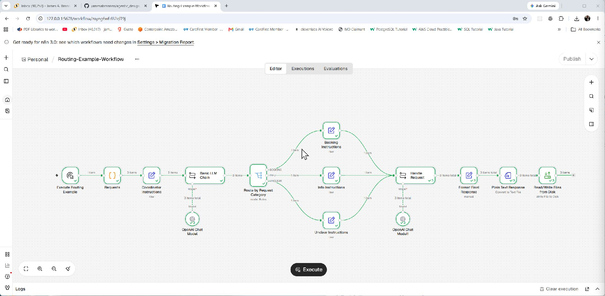
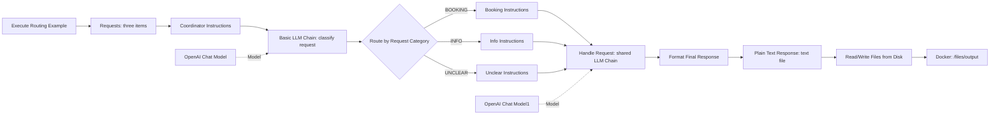

# Chapter 2: Routing workflow

The `Routing-Example-Workflow` implements the same booking, information, and unclear-request scenario as the [Java routing examples](../java/docs/routing-pattern.md). An LLM classifies each request, a Switch selects a branch, and a second LLM call generates a response using the selected branch's instructions. The final nodes format the response, convert it to a text file, and write it to a Docker-mounted Windows folder.

This walkthrough describes the exported workflow and visible canvas captured on 2026-11-25. The original mapping table above remains a suggested mapping; this section documents the concrete routing implementation.

### Workflow screenshot



The screenshot shows the executed workflow. Solid connections carry workflow items; dashed model connections supply an OpenAI model to an LLM Chain. Green indicators show execution status, not a guarantee that a model answer is correct.

### Flow diagram



Classification determines the route. The Switch and instruction nodes make no model calls. Both LLM Chains use `gpt-5-mini` in the captured workflow. A normal successful execution makes three classification calls and three handler calls, excluding retries.

### 1. Generate the three requests

**Execute Routing Example** is a Manual Trigger. **Requests** is a Code node running once for all incoming items:

```javascript
return [
  { json: { request: "Book me a flight to London." } },
  { json: { request: "What is the capital of Italy?" } },
  { json: { request: "Do that thing for me." } }
];
```

The node returns three n8n items. Each item has its own `json.request`; this differs from placing an array of requests inside one item. The downstream nodes process the items without an explicit Loop Over Items node.

| Request | Intended classification |
| --- | --- |
| Book me a flight to London. | `BOOKING` |
| What is the capital of Italy? | `INFO` |
| Do that thing for me. | `UNCLEAR` |

These categories are the intended behavior for the sample inputs. The actual model response controls the Switch.

### 2. Attach coordinator instructions

**Coordinator Instructions** is an Edit Fields node using **JSON** mode. Its configuration adds an `INSTRUCTIONS` field:

```json
{
  "INSTRUCTIONS": "Classify the user's request into exactly one category:\nBOOKING: Requests related to booking flights or hotels.\nINFO: General information questions.\nUNCLEAR: Ambiguous requests or requests outside those categories.\nReturn only BOOKING, INFO, or UNCLEAR. Do not answer the request itself."
}
```

**Include Other Input Fields** is enabled. Each output item therefore contains both `request` and `INSTRUCTIONS`. Without this setting, the node would discard the request when constructing its output.

The JSON object holds workflow fields. The instructions themselves are ordinary prompt text; this is not a schema constraining the classifier's response.

### 3. Classify with Basic LLM Chain

The first **Basic LLM Chain** serves as the coordinator:

| Setting | Value |
| --- | --- |
| Source for Prompt (User Message) | Define below |
| Prompt (User Message), Expression | `{{ $json.request }}` |
| Chat message role | System |
| System Message, Expression | `{{ $json.INSTRUCTIONS }}` |
| Connected model | OpenAI Chat Model, `gpt-5-mini` |
| Require Specific Output Format | Off |

The prompt-source selector must contain **Define below**, not an expression containing instructions. Similarly, the message-role selector must contain **System**; the expression belongs in its **Message** field.

The LLM Chain returns its generated answer in `text`. A representative classification item is:

```json
{
  "text": "BOOKING"
}
```

The OpenAI Chat Model is a model sub-node. It supplies credentials and model configuration to the chain; it is not a standalone step in the main item-processing path. Neither chain is configured as an AI Agent with tools or memory.

### 4. Route on the classification

**Route by Request Category** is a Switch node in **Rules** mode. Each rule uses this left-hand expression:

```javascript
{{ $json.text.trim() }}
```

| Rule | Comparison | Output name |
| --- | --- | --- |
| 1 | is equal to `BOOKING` | BOOKING |
| 2 | is equal to `INFO` | INFO |
| 3 | is equal to `UNCLEAR` | UNCLEAR |

`trim()` removes surrounding whitespace. Comparisons are case-sensitive. The Switch does not normalize quotation marks, explanatory sentences, or different casing. `UNCLEAR` is an explicit category, not a fallback for unexpected model output. No fallback output is configured; an unmatched item does not reach a handler.

### 5. Select instructions and recover the original request

Each Switch output connects to an Edit Fields node:

| Node | Handler instructions |
| --- | --- |
| Booking Instructions | Briefly acknowledge the travel request. Ask no questions and do not claim to make bookings or check availability. |
| Info Instructions | Briefly answer the general knowledge question, acknowledge uncertainty, and do not claim live research or ask follow-up questions. |
| Unclear Instructions | Ask the model to reply only `Your request was unclear.` without follow-up questions. |

The classifier's output contains `text`, so these nodes retrieve the original input through n8n item linking:

```javascript
{{ $('Coordinator Instructions').item.json.request }}
```

`.item` refers to the upstream item associated with the current classification. It avoids selecting the first sample for every branch. The node named in the expression must remain resolvable if the workflow is reorganized.

Each instruction node builds an object with three fields:

```json
{
  "request": "Book me a flight to London.",
  "category": "BOOKING",
  "handlerInstructions": "You are a booking assistant. Acknowledge the user's travel request briefly. Do not ask questions or request additional details. Do not claim to have booked anything or checked live availability."
}
```

In the actual JSON-mode configuration, an expression constructs this object and `JSON.stringify(...)` serializes it for the node's JSON parameter. The full expressions are included in the export below. `category` is carried with the branch data; the shared chain uses `request` and `handlerInstructions`.

### 6. Generate the response with one shared handler chain

All three instruction nodes connect directly to **Handle Request**, a second Basic LLM Chain:

| Setting | Value |
| --- | --- |
| Source for Prompt (User Message) | Define below |
| Prompt (User Message), Expression | `{{ $json.request }}` |
| Chat message role | System |
| System Message, Expression | `{{ $json.handlerInstructions }}` |
| Connected model | OpenAI Chat Model1, `gpt-5-mini` |

There are three instruction branches but only one handler chain configuration. Whichever branch supplies the item determines the system instructions for that invocation. The original request remains the user prompt.

This is similar to the Java handlers sharing `OpenAiTextService`: specialized instructions vary, while model-call mechanics are shared. Separate chains would be useful if branches needed different models, tools, or generation settings. Here, one shared chain keeps those settings in one place.

The chain can execute separately for each incoming branch. The lines converging on it do not collect all responses into one item or create a synchronized merge. With the sample inputs routed to distinct categories, the handler and final output nodes execute three times, once for each branch's item.

### 7. Format a plain string

**Format Final Response** is an Edit Fields node using **Manual Mapping**. It creates a String field named `message` with this expression:

```javascript
{{ String.fromCharCode(65279) + 'Response:\n\n' + $json.text + '\n\n— End of response —' }}
```

The expression adds a heading, blank lines, the handler's answer, and a footer. `String.fromCharCode(65279)` adds the Unicode byte-order mark at the beginning; when the message is converted to a UTF-8 text file, this lets the browser preview recognize its encoding and display punctuation correctly.

This node does not make an LLM call or rewrite the model's answer. The message is a plain string, but n8n still transports it in an item such as `{ "message": "..." }`. Its output viewer may display line breaks as `\n`; changing the field does not turn that viewer into a rendered document.

### 8. Convert the string into a text file

**Plain Text Response** is a Convert to File node:

| Setting | Value |
| --- | --- |
| Operation | Convert to Text File |
| Text Input Field | `message` |
| Put Output File in Field | `data` (default) |

`message` is the input field name, not an expression containing the message text. The node converts that string to binary file data. Its Binary output offers **View** for readable paragraphs and **Download** for a manual browser download. The default binary filename is `file.txt`; the next node determines the on-disk destination name.

### 9. Write each response to disk

**Read/Write Files from Disk** uses **Write File to Disk**, with the default input binary field `data`. Its **File Path and Name** is:

```javascript
{{ '/files/output/output-' + $execution.id + '-' + ($runIndex + 1) + '.txt' }}
```

The execution ID separates workflow runs. `$runIndex + 1` distinguishes separate invocations of the file-writing node within the same execution. For the current branch-per-request workflow, this produces files such as:

```text
output-18-1.txt
output-18-2.txt
output-18-3.txt
```

Those three files were present in the local output folder when this document was prepared. The numeric suffix reflects node invocation order, not a permanent booking/info/unclear identifier. If a later design passes multiple items in one node invocation, filenames would also need an item index or another unique item identifier.

A fixed filename would be reused; n8n does not automatically add sequence numbers. Append is not enabled in this workflow.

### 10. Docker storage and setup

The running container's output mount maps:

| Location | Path |
| --- | --- |
| Inside the n8n container | `/files/output` |
| Windows host | `D:\agentic_design_patterns_book_notes\n8n\storage\files` |

The [Compose configuration](compose.yml) mounts `./storage/files` at `/files/output` and sets `N8N_RESTRICT_FILE_ACCESS_TO` to `/files`. The write node uses the container path, not the Windows path and not `/storage/files`. The output directory was verified to exist and be writable in the running container.

Before running an imported copy:

1. Select your OpenAI credential in both OpenAI Chat Model nodes.
2. Confirm the configured model is available to your account.
3. Ensure `/files/output` exists, is writable, and maps to the intended host directory.
4. Start the workflow with the Manual Trigger. This makes live OpenAI requests and writes text files.
5. Inspect each branch and the resulting files. Successful node execution does not establish that every generated answer follows its instructions.

### 11. Validation and limitations

The captured canvas shows all three routing branches and the file-writing stage executed. The user reported successful disk output, and the three `output-18-*.txt` files were found locally. Their bytes included the UTF-8 byte-order mark and actual line breaks, rather than literal backslash-n sequences.

The workflow export and screenshot were inspected for this documentation update. No new workflow execution or model calls were made to produce this document.

This is a small learning demo. Booking is acknowledged rather than performed, information answers are not backed by live search, and prompt wording does not guarantee exact model behavior. Classification uses ordinary text rather than schema-constrained output. The workflow has no configured fallback route, custom recovery loop, or conversation memory.

### Workflow JSON

[Download the importable workflow JSON](workflows/routing-example-workflow.json).

The following JSON preserves the exported node parameters, positions, and connections. Local credential references and instance/version identifiers have been omitted, pinned output is empty, and the exported copy is inactive. Select your own credential after importing. These documentation artifacts do not change the running workflow.

<details>
<summary>Expand the complete routing workflow JSON</summary>

```json
{
  "name": "Routing-Example-Workflow",
  "nodes": [
    {
      "parameters": {},
      "type": "n8n-nodes-base.manualTrigger",
      "typeVersion": 1,
      "position": [
        -944,
        -32
      ],
      "id": "5159c17a-f23b-4448-8f47-d4b29e9ab224",
      "name": "Execute Routing Example"
    },
    {
      "parameters": {
        "jsCode": "return [\n  { json: { request: \"Book me a flight to London.\" } },\n  { json: { request: \"What is the capital of Italy?\" } },\n  { json: { request: \"Do that thing for me.\" } }\n];"
      },
      "type": "n8n-nodes-base.code",
      "typeVersion": 2,
      "position": [
        -704,
        -32
      ],
      "id": "73271f9d-2c51-4a89-b579-c9963155c0e3",
      "name": "Requests"
    },
    {
      "parameters": {
        "mode": "raw",
        "jsonOutput": "{\n  \"INSTRUCTIONS\": \"Classify the user's request into exactly one category:\\nBOOKING: Requests related to booking flights or hotels.\\nINFO: General information questions.\\nUNCLEAR: Ambiguous requests or requests outside those categories.\\nReturn only BOOKING, INFO, or UNCLEAR. Do not answer the request itself.\"\n}\n",
        "includeOtherFields": true,
        "options": {}
      },
      "type": "n8n-nodes-base.set",
      "typeVersion": 3.5,
      "position": [
        -480,
        -32
      ],
      "id": "bd2df97f-230a-4375-9cc7-76ea55d84045",
      "name": "Coordinator Instructions"
    },
    {
      "parameters": {
        "promptType": "define",
        "text": "={{ $json.request }}",
        "messages": {
          "messageValues": [
            {
              "message": "={{ $json.INSTRUCTIONS }}"
            }
          ]
        },
        "batching": {}
      },
      "type": "@n8n/n8n-nodes-langchain.chainLlm",
      "typeVersion": 1.9,
      "position": [
        -240,
        -32
      ],
      "id": "3cc1b354-c127-4f81-a4ff-d54542bc01ff",
      "name": "Basic LLM Chain"
    },
    {
      "parameters": {
        "model": {
          "__rl": true,
          "mode": "list",
          "value": "gpt-5-mini"
        },
        "builtInTools": {},
        "options": {}
      },
      "type": "@n8n/n8n-nodes-langchain.lmChatOpenAi",
      "typeVersion": 1.3,
      "position": [
        -240,
        224
      ],
      "id": "1e5c7f65-8690-4239-af7b-7e77e6af5f2c",
      "name": "OpenAI Chat Model"
    },
    {
      "parameters": {
        "rules": {
          "values": [
            {
              "conditions": {
                "options": {
                  "caseSensitive": true,
                  "leftValue": "",
                  "typeValidation": "strict",
                  "version": 4
                },
                "conditions": [
                  {
                    "leftValue": "={{ $json.text.trim() }}",
                    "rightValue": "BOOKING",
                    "operator": {
                      "type": "string",
                      "operation": "equals"
                    },
                    "id": "59e9b3e6-2f31-464e-a7da-f579b9f4818a"
                  }
                ],
                "combinator": "and"
              },
              "renameOutput": true,
              "outputKey": "BOOKING"
            },
            {
              "conditions": {
                "options": {
                  "caseSensitive": true,
                  "leftValue": "",
                  "typeValidation": "strict",
                  "version": 4
                },
                "conditions": [
                  {
                    "id": "70cea7c7-1ee1-4e9f-b79c-76b6e1908377",
                    "leftValue": "={{ $json.text.trim() }}",
                    "rightValue": "INFO",
                    "operator": {
                      "type": "string",
                      "operation": "equals",
                      "name": "filter.operator.equals"
                    }
                  }
                ],
                "combinator": "and"
              },
              "renameOutput": true,
              "outputKey": "INFO"
            },
            {
              "conditions": {
                "options": {
                  "caseSensitive": true,
                  "leftValue": "",
                  "typeValidation": "strict",
                  "version": 4
                },
                "conditions": [
                  {
                    "id": "65138a24-56d1-42cb-9923-f690ca93db4d",
                    "leftValue": "={{ $json.text.trim() }}",
                    "rightValue": "UNCLEAR",
                    "operator": {
                      "type": "string",
                      "operation": "equals",
                      "name": "filter.operator.equals"
                    }
                  }
                ],
                "combinator": "and"
              },
              "renameOutput": true,
              "outputKey": "UNCLEAR"
            }
          ]
        },
        "options": {}
      },
      "type": "n8n-nodes-base.switch",
      "typeVersion": 3.5,
      "position": [
        128,
        -48
      ],
      "id": "0757fa2b-c91e-44e7-9248-96ae21b05bf5",
      "name": "Route by Request Category"
    },
    {
      "parameters": {
        "promptType": "define",
        "text": "={{ $json.request }}",
        "messages": {
          "messageValues": [
            {
              "message": "={{ $json.handlerInstructions }}"
            }
          ]
        },
        "batching": {}
      },
      "type": "@n8n/n8n-nodes-langchain.chainLlm",
      "typeVersion": 1.9,
      "position": [
        960,
        -32
      ],
      "id": "88de532c-5901-49a5-b93d-c2c00ff3541f",
      "name": "Handle Request"
    },
    {
      "parameters": {
        "model": {
          "__rl": true,
          "mode": "list",
          "value": "gpt-5-mini"
        },
        "builtInTools": {},
        "options": {}
      },
      "type": "@n8n/n8n-nodes-langchain.lmChatOpenAi",
      "typeVersion": 1.3,
      "position": [
        960,
        224
      ],
      "id": "3ceb05e2-e48b-405f-83ac-371c0d1c7388",
      "name": "OpenAI Chat Model1"
    },
    {
      "parameters": {
        "mode": "raw",
        "jsonOutput": "={{ JSON.stringify({ request: $(\"Coordinator Instructions\").item.json.request, category: $json.text.trim(), handlerInstructions: \"You are a booking assistant. Acknowledge the user's travel request briefly. Do not ask questions or request additional details. Do not claim to have booked anything or checked live availability.\" }) }}",
        "options": {}
      },
      "type": "n8n-nodes-base.set",
      "typeVersion": 3.5,
      "position": [
        544,
        -288
      ],
      "id": "9ea37567-0256-4cdc-a059-587d48cfae9a",
      "name": "Booking Instructions"
    },
    {
      "parameters": {
        "mode": "raw",
        "jsonOutput": "={{ JSON.stringify({ request: $(\"Coordinator Instructions\").item.json.request, category: $json.text.trim(), handlerInstructions: \"You are an information assistant. Answer the user's general knowledge question briefly and clearly. Acknowledge uncertainty when you do not know the answer. Do not claim to have searched the web or checked live information. Do not ask questions or request additional details.\" }) }}",
        "options": {}
      },
      "type": "n8n-nodes-base.set",
      "typeVersion": 3.5,
      "position": [
        544,
        -32
      ],
      "id": "2fbeb28b-5046-41c7-b92e-3af2e234bc99",
      "name": "Info Instructions"
    },
    {
      "parameters": {
        "mode": "raw",
        "jsonOutput": "={{ JSON.stringify({ request: $(\"Coordinator Instructions\").item.json.request, category: $json.text.trim(), handlerInstructions: \"Reply only with: Your request was unclear. Do not ask questions or request additional details.\" }) }}",
        "options": {}
      },
      "type": "n8n-nodes-base.set",
      "typeVersion": 3.5,
      "position": [
        544,
        224
      ],
      "id": "44d2475c-9d8d-4e49-9e1c-12bf1f03bbf3",
      "name": "Unclear Instructions"
    },
    {
      "parameters": {
        "assignments": {
          "assignments": [
            {
              "id": "059184cc-7d0e-45ab-bc15-7fa3b8fc361c",
              "name": "message",
              "value": "={{ String.fromCharCode(65279) + 'Response:\\n\\n' + $json.text + '\\n\\n— End of response —' }}",
              "type": "string"
            }
          ]
        },
        "options": {}
      },
      "type": "n8n-nodes-base.set",
      "typeVersion": 3.5,
      "position": [
        1328,
        -32
      ],
      "id": "486c2941-67c3-4c1b-9d74-e7bb52e23ff1",
      "name": "Format Final Response"
    },
    {
      "parameters": {
        "operation": "toText",
        "sourceProperty": "message",
        "options": {}
      },
      "type": "n8n-nodes-base.convertToFile",
      "typeVersion": 1.2,
      "position": [
        1552,
        -32
      ],
      "id": "68914a53-5edd-485a-937d-8103fb0ffa02",
      "name": "Plain Text Response"
    },
    {
      "parameters": {
        "operation": "write",
        "fileName": "={{ '/files/output/output-' + $execution.id + '-' + ($runIndex + 1) + '.txt' }}",
        "options": {}
      },
      "type": "n8n-nodes-base.readWriteFile",
      "typeVersion": 1.1,
      "position": [
        1776,
        -32
      ],
      "id": "20d85b89-47a9-4264-b097-770519f5b3c9",
      "name": "Read/Write Files from Disk"
    }
  ],
  "connections": {
    "Execute Routing Example": {
      "main": [
        [
          {
            "node": "Requests",
            "type": "main",
            "index": 0
          }
        ]
      ]
    },
    "Requests": {
      "main": [
        [
          {
            "node": "Coordinator Instructions",
            "type": "main",
            "index": 0
          }
        ]
      ]
    },
    "Coordinator Instructions": {
      "main": [
        [
          {
            "node": "Basic LLM Chain",
            "type": "main",
            "index": 0
          }
        ]
      ]
    },
    "Basic LLM Chain": {
      "main": [
        [
          {
            "node": "Route by Request Category",
            "type": "main",
            "index": 0
          }
        ]
      ]
    },
    "OpenAI Chat Model": {
      "ai_languageModel": [
        [
          {
            "node": "Basic LLM Chain",
            "type": "ai_languageModel",
            "index": 0
          }
        ]
      ]
    },
    "Route by Request Category": {
      "main": [
        [
          {
            "node": "Booking Instructions",
            "type": "main",
            "index": 0
          }
        ],
        [
          {
            "node": "Info Instructions",
            "type": "main",
            "index": 0
          }
        ],
        [
          {
            "node": "Unclear Instructions",
            "type": "main",
            "index": 0
          }
        ]
      ]
    },
    "OpenAI Chat Model1": {
      "ai_languageModel": [
        [
          {
            "node": "Handle Request",
            "type": "ai_languageModel",
            "index": 0
          }
        ]
      ]
    },
    "Booking Instructions": {
      "main": [
        [
          {
            "node": "Handle Request",
            "type": "main",
            "index": 0
          }
        ]
      ]
    },
    "Info Instructions": {
      "main": [
        [
          {
            "node": "Handle Request",
            "type": "main",
            "index": 0
          }
        ]
      ]
    },
    "Unclear Instructions": {
      "main": [
        [
          {
            "node": "Handle Request",
            "type": "main",
            "index": 0
          }
        ]
      ]
    },
    "Handle Request": {
      "main": [
        [
          {
            "node": "Format Final Response",
            "type": "main",
            "index": 0
          }
        ]
      ]
    },
    "Format Final Response": {
      "main": [
        [
          {
            "node": "Plain Text Response",
            "type": "main",
            "index": 0
          }
        ]
      ]
    },
    "Plain Text Response": {
      "main": [
        [
          {
            "node": "Read/Write Files from Disk",
            "type": "main",
            "index": 0
          }
        ]
      ]
    }
  },
  "settings": {
    "executionOrder": "v1",
    "binaryMode": "separate"
  },
  "active": false,
  "pinData": {}
}
```

</details>

> **Note:** This document was generated by Codex.
