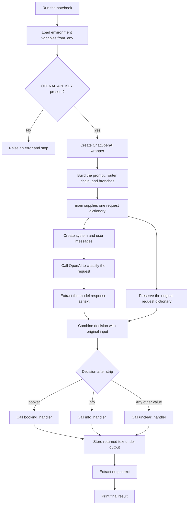

> **Note:** The notebook contains a LangChain routing pipeline and a direct OpenAI Python SDK alternative. It does not define a LangGraph graph.

# Chapter 02: Routing with LangChain and OpenAI — Notes

These notes explain [Chapter_02_Routing_langchain_openai.ipynb](../Chapter_02_Routing_langchain_openai.ipynb), using OpenAI's `gpt-4.1-mini` and a `.env` file. This is the remaining Chapter 2 notebook; the Google ADK and OpenRouter examples have been removed. The LangChain implementation is explained first, followed by the direct OpenAI Python SDK alternative.

## What this notebook demonstrates

Think of a receptionist deciding which department should receive a request. The receptionist reads the request, selects a department, and forwards the original message there.

The notebook implements that **routing pattern**:

1. Give a language model a request and rules for categorizing it.
2. Ask the model for one label: `booker`, `info`, or `unclear`.
3. Use Python logic to call the matching function.
4. Return that function's result.

The model performs the classification. The handler functions are simulations: they return prepared messages. They do not book flights, search for information, or ask another model to answer a question.

The first implementation uses **LangChain runnable chains**. It does not import LangGraph, define a `StateGraph`, or compile graph nodes and edges. The diagram below describes that implementation's logical flow.

## Flow diagram

This diagram follows the LangChain routing pipeline implemented in the notebook.



`main()` sends three requests through this path, one after another. The diagram shows the normal successful initialization path; initialization and API failures are discussed below. A Markdown viewer with Mermaid support can render this code block as a graph. Otherwise, the block remains readable as diagram source.

## 1. Imports: bringing in the building blocks

Python's `import` statements make functionality from other modules available in this notebook.

| Import | Purpose here |
| --- | --- |
| `os` | Reads the `OPENAI_API_KEY` environment variable. |
| `load_dotenv` | Loads values from a `.env` file into the process environment. |
| `ChatOpenAI` | Gives LangChain a common interface for calling an OpenAI chat model. |
| `ChatPromptTemplate` | Builds messages from reusable text and input values. |
| `StrOutputParser` | Extracts response text from the model's message object. |
| `RunnablePassthrough` | Preserves input data as it passes through a chain. |
| `RunnableBranch` | Chooses one processing path using conditions. |

A **runnable** is a LangChain component you can execute with input. A **chain** connects components so the output of one becomes the input of the next.

## 2. Configuration: loading the key and choosing the model

```python
load_dotenv()
if not os.getenv('OPENAI_API_KEY'):
    raise RuntimeError('Set OPENAI_API_KEY in the .env file before running this notebook.')
```

An environment variable is a named setting available to the running Python process. `load_dotenv()` searches for a `.env` file using its discovery rules; when running this notebook from its folder, the intended file is the `.env` beside the notebook. Existing environment variables take precedence by default.

`os.getenv(...)` returns the setting's value, or `None` if it is missing. `if not ...` detects a missing or empty value. `raise RuntimeError(...)` stops execution with an explanatory error. This checks presence; it does not prove that the key is valid.

```python
llm = ChatOpenAI(model="gpt-4.1-mini", temperature=0)
```

`llm` is a variable holding the model wrapper. `temperature=0` requests low variability; it does not guarantee identical answers on every run. Creating this wrapper does not itself classify a request. The API call happens when the chain is invoked later.

`try` and `except` handle exceptions during wrapper initialization. If initialization raises an exception, the code prints the error and sets `llm = None`.

## 3. Handlers: ordinary Python functions

```python
def booking_handler(request: str) -> str:
    print("\n--- DELEGATING TO BOOKING HANDLER ---")
    return f"Booking Handler processed request: '{request}'. Result: Simulated booking action."
```

- `def` defines a function: a named block of reusable code.
- `request` is its input parameter.
- `: str` and `-> str` are type hints indicating a string input and a string return value. They do not enforce types by themselves.
- Indentation marks the statements that belong inside the function.
- `print(...)` displays a message for the person running the notebook.
- `return` gives a value back to the calling code.
- An `f"..."` string inserts values inside `{...}` into the text.
- `\n` adds a line break.

The information and unclear handlers work the same way. Defining a function does not execute its body; the selected branch calls it later.

These functions are described as sub-agent handlers in comments, but they are regular Python functions. Only the router uses a language model.

## 4. The prompt: asking for a category

`ChatPromptTemplate.from_messages(...)` builds two messages:

- A **system message** explains the classification rules and restricts the expected output to three words.
- A **user message** contains `{request}`, a placeholder filled with the actual input text.

For example, invoking the chain with:

```python
{"request": "Book me a flight to London."}
```

fills the user message with `Book me a flight to London.` The braces in the prompt identify a template variable; the braces around the input above create a Python dictionary.

The prompt requests a constrained answer, but it does not enforce an output schema. The model can still return unexpected text.

## 5. The router chain: what the pipe means

```python
coordinator_router_chain = coordinator_router_prompt | llm | StrOutputParser()
```

LangChain uses Python's `|` operator to connect these components. Read this expression from left to right:

**Input dictionary → formatted messages → OpenAI response → response text**

`StrOutputParser()` extracts the message's textual content. It does not check that the text is one of the allowed labels.

The chain is built inside `if llm:` so that this particular assignment happens only when a wrapper exists.

## 6. Branches: mapping a label to a function

A Python **dictionary** stores named values:

```python
{"decision": "booker", "request": {"request": "Book me a flight to London."}}
```

`x['decision']` looks up the value under the key `decision`.

A **lambda** is a short function written inline:

```python
lambda x: x['decision'].strip() == 'booker'
```

This receives `x`, removes whitespace from the ends of the decision string with `.strip()`, and tests whether it equals `booker`. The `==` operator compares values; `=` assigns a value.

`RunnableBranch` checks its conditions in order:

1. If the label is `booker`, select the booking branch.
2. Otherwise, if it is `info`, select the information branch.
3. Otherwise, select the unclear branch.

This last branch is a default. It covers both an explicit `unclear` response and unexpected responses. Comparisons are case-sensitive: `Booker` or `booker.` would use the default branch.

## 7. Why the request is nested twice

The main chain starts with this mapping:

```python
{
    "decision": coordinator_router_chain,
    "request": RunnablePassthrough()
}
```

In this chain expression, LangChain treats the dictionary as a mapping of runnable components. Both receive the same original input. One produces the model's decision; the other preserves the whole input dictionary.

Given the input:

```python
{"request": "Book me a flight to London."}
```

and a model response of `booker`, the combined result is:

```python
{
    "decision": "booker",
    "request": {
        "request": "Book me a flight to London."
    }
}
```

That explains the handler expression:

```python
x['request']['request']
```

The first lookup gets the preserved dictionary. The second gets the text inside it. This nesting comes from the way this example assembles its data; it is not a general LangChain requirement.

```python
RunnablePassthrough.assign(
    output=lambda x: booking_handler(x['request']['request'])
)
```

`.assign(...)` preserves the existing fields and adds an `output` field containing the handler's returned string. The final component:

```python
lambda x: x['output']
```

extracts just that string so the caller receives a simple result rather than the entire dictionary.

## 8. Running the complete chain

```python
result_a = coordinator_agent.invoke({"request": request_a})
```

`.invoke(...)` executes the assembled pipeline. This is where the router calls OpenAI and the selected handler runs. Each invocation makes one model request on its normal successful path; the handler does not make another model request. Client retries can result in additional attempts if a request fails.

`main()` invokes the chain three times, sequentially:

| Example | Expected route | What the handler actually returns |
| --- | --- | --- |
| `Book me a flight to London.` | `booker` | A message reporting a simulated booking action. |
| `What is the capital of Italy?` | `info` | A message reporting simulated information retrieval, rather than the capital itself. |
| `Tell me about quantum physics.` | Usually `info` under the prompt's rules | The information handler's simulated response. |

The third example is labeled an “unclear request” by the notebook's printed heading. Its text is a general information request, so that heading does not reliably describe its route. The model's classification controls the branch.

```python
if __name__ == "__main__":
    main()
```

This is Python's usual “run the entry point when executing this code directly” convention. In a normal Jupyter notebook, `__name__` is `"__main__"`, so running the cell calls `main()`.

## Limitations to understand

- The examples demonstrate routing and simulated responses. They do not implement real booking or retrieval services.
- The code does not validate the category using a structured schema. Unexpected text falls through to the unclear handler.
- The initialization failure handling has a gap: if constructing `llm` fails, `coordinator_router_chain` is not assigned, but the code still references it while building `coordinator_agent`. On a fresh run, that can raise `NameError` before `main()` reaches its intended skip check.
- The `try` block surrounds initialization only. Authentication failures, network failures, or API errors during `.invoke()` are not caught by that block.
- Re-running a notebook cell can leave old variables in the kernel. Restarting the kernel and running from the top gives a clearer view of initialization failures.
- These notes explain the source code; the notebook was not executed to verify live model outputs while writing them.

## The main idea to retain

The language model chooses a label. Python uses that label to select a function. LangChain connects the prompt, model, text extraction, and branching logic into one callable pipeline.

## Alternative implementation: OpenAI Python SDK

The following version implements the same routing pattern using the official OpenAI Python SDK and ordinary Python conditions. It is a separate alternative to the LangChain implementation described above. It retains `gpt-4.1-mini`, the `.env` configuration, and the simulated handlers.

If needed, install the dependencies in a separate notebook cell:

```python
# Dependency setup generated by Codex.
%pip install -qU openai python-dotenv
```

The notebook now includes this alternative in a separate code cell; the code is reproduced below for reference. Creating the client does not send a request. Running the final `main()` call makes three classification requests on the normal successful path; SDK retries can cause additional attempts. This alternative has not been executed or verified against the live API as part of this notes update.

```python
# Adapted from the routing example credited to Marco Fago.
# Copyright (c) 2025 Marco Fago
# OpenAI SDK conversion generated by Codex.
# MIT License; see the repository LICENSE.

import os

from dotenv import load_dotenv
from openai import OpenAI


# --- Configuration ---

load_dotenv()

if not os.getenv("OPENAI_API_KEY"):
    raise RuntimeError(
        "Set OPENAI_API_KEY in the .env file before running this notebook."
    )

# Creating the client does not send an API request.
client = OpenAI()

MODEL = "gpt-4.1-mini"

ROUTING_INSTRUCTIONS = """
Analyze the user's request and determine which specialist handler should process it.

- If the request is related to booking flights or hotels, output 'booker'.
- For all other general information questions, output 'info'.
- If the request is unclear or doesn't fit either category, output 'unclear'.

ONLY output one word: 'booker', 'info', or 'unclear'.
"""


# --- Ordinary Python handlers: no API calls ---

def booking_handler(request: str) -> str:
    """Simulates the Booking Agent handling a request."""
    print("\n--- DELEGATING TO BOOKING HANDLER ---")
    return (
        f"Booking Handler processed request: '{request}'. "
        "Result: Simulated booking action."
    )


def info_handler(request: str) -> str:
    """Simulates the Info Agent handling a request."""
    print("\n--- DELEGATING TO INFO HANDLER ---")
    return (
        f"Info Handler processed request: '{request}'. "
        "Result: Simulated information retrieval."
    )


def unclear_handler(request: str) -> str:
    """Handles requests that could not be delegated."""
    print("\n--- HANDLING UNCLEAR REQUEST ---")
    return (
        f"Coordinator could not delegate request: '{request}'. "
        "Please clarify."
    )


# --- Classification: this function makes the API call ---

def classify_request(request: str) -> str:
    response = client.responses.create(
        model=MODEL,
        instructions=ROUTING_INSTRUCTIONS,
        input=request,
        temperature=0,
    )

    decision = response.output_text.strip()
    print(f"Router decision: {decision!r}")

    return decision


# --- Routing: ordinary Python conditions ---

def coordinator_agent(request: str) -> str:
    decision = classify_request(request)

    if decision == "booker":
        return booking_handler(request)
    elif decision == "info":
        return info_handler(request)
    else:
        # Includes "unclear" and any unexpected model output.
        return unclear_handler(request)


# --- Example usage ---

def main():
    print("--- Running with a booking request ---")
    result_a = coordinator_agent("Book me a flight to London.")
    print(f"Final Result A: {result_a}")

    print("\n--- Running with an info request ---")
    result_b = coordinator_agent("What is the capital of Italy?")
    print(f"Final Result B: {result_b}")

    print("\n--- Running with an unclear request ---")
    result_c = coordinator_agent("Do that thing for me.")
    print(f"Final Result C: {result_c}")


# Running this cell makes three classification API requests.
main()
```

### Construction and execution order

1. `load_dotenv()` loads configuration, and the presence check verifies that `OPENAI_API_KEY` is set. Existing environment variables take precedence.
2. `OpenAI()` constructs the API client. `MODEL` and `ROUTING_INSTRUCTIONS` hold its request settings.
3. The `def` statements define functions without running their bodies.
4. The final `main()` call starts execution and supplies each example request.
5. `coordinator_agent(request)` calls `classify_request(request)`.
6. `client.responses.create(...)` sends the instructions and request to OpenAI. `instructions=` specifies how the model should classify; `input=` supplies the text being classified.
7. `response.output_text.strip()` reads the classification and removes surrounding whitespace. The `!r` in the diagnostic print displays a representation of the string, including quotes.
8. `if/elif/else` selects a handler, which returns its simulated result to the caller.

There are no prompt-template objects, runnable branches, nested request dictionaries, or pipe expressions in this alternative. The instructions remain text sent to the model; the Python conditions perform the routing. Unexpected classifications use the unclear handler. API failures propagate as exceptions rather than being treated as unclear requests.

The ambiguous third request replaces the original quantum-physics example, which fits the information category under the routing instructions. The information handler still returns a simulated retrieval message rather than answering the question itself.

API reference: [OpenAI Python SDK](https://developers.openai.com/api/reference/python).
